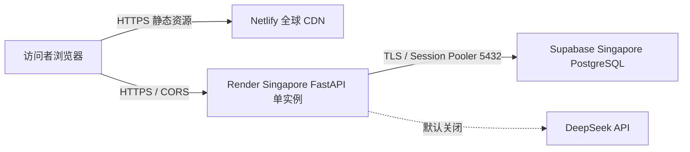

# P9 架构决策记录

- 日期：2026-11-11
- 状态：P9-1 已确认，P9-2 已确定首版拓扑
- 数据边界：所有云端数据均为生成的 Mock 数据

## 已确认决策

| ID | 决策 | 理由/影响 |
|---|---|---|
| ADR-P9-01 | 使用 Supabase PostgreSQL，区域优先 Singapore | 项目方已有 Supabase 使用经验；不部署大陆站点；创建时仍需核实控制台是否提供该区域 |
| ADR-P9-02 | Netlify Free 托管 React/Vite 静态前端 | 静态站点无需常驻计算；先使用 Netlify 平台子域名 |
| ADR-P9-03 | Render Singapore Starter 托管 FastAPI | 保留现有 Python API；最小付费常驻规格用于避免 Free 休眠 |
| ADR-P9-04 | 估算固定月费 $32（约 ¥215） | Netlify $0 + Render $7 + Supabase Pro $25；DeepSeek 调用、超额用量、税费及自定义域名另计；报价依据见云平台比较文档 |
| ADR-P9-05 | Render API 单实例 | 当前会话、澄清状态、debug owner 均在进程内存；不支持多副本共享。重启后已有会话失效，用户可重新开始 |
| ADR-P9-06 | 公开匿名演示只使用 Mock 数据 | 前端允许切换演示角色；API 将角色能力限定为演示权限。公开模式关闭 SQL debug 和管理员反馈汇总 |
| ADR-P9-07 | 发布首版默认关闭 DeepSeek | 公开匿名入口可能导致模型费用被第三方触发；完成调用限额和账单告警方案后，再单独启用 |
| ADR-P9-08 | Supabase Session Pooler 5432 | Render 网络按 IPv4 连接 Supabase，使用共享 Session Pooler；连接串只放 Render Secret，不进入前端或源码 |
| ADR-P9-09 | 不购买自定义域名 | 先使用 Netlify/Render 平台子域名；中国大陆访问情况需实测，不保证无代理可达 |
| ADR-P9-10 | owner 连接串只在本机 SecureString 输入，不放进 Render 环境 | Render 环境变量同时对 API 进程可见，避免把 schema/导入权限交给公网服务进程 |

## 拓扑

## 迁移策略

1. Supabase 项目仅用于该作品集的 Mock 环境，不复用有真实业务数据的项目。
2. Alembic schema migration 在本机通过 SecureString 提示输入 owner Session Pooler URL 后执行；迁移失败时停止后续部署。新增 schema revision 时先运行迁移，再部署 API。
3. 首次导入使用显式脚本 `scripts/seed_cloud_mock.py`，仅接受 PostgreSQL；须显式传入 `--confirm-empty-mock-target`，并且所有应用表必须为空。该脚本复用数据 manifest 校验，不重置或覆盖非空目标。
4. 导入后核对 manifest、行数、外键和 P5/P6 报告；失败时从 Supabase 新建空数据库重做，首版不对已公开环境执行破坏性清库。
5. Alembic 本机使用 `CHATBI_MIGRATION_DATABASE_URL`；Render API 只使用独立低权限 `chatbi_app` 的 `CHATBI_DATABASE_URL`，仅可读业务 Mock 表并写入反馈表。owner URL 不进入 Render 环境；首次导入同样在本机通过隐藏提示输入 owner URL。
6. 应用只使用 Supabase 数据库连接串；不把 Supabase `service_role` 或其他管理密钥放到前端。此项目直接由 SQLAlchemy 连接 PostgreSQL，不需要 Supabase anon key。

## 需要实测的项目

- Supabase 新建项目的区域选项和 Singapore 价格/连接方式。
- Render Singapore 到 Supabase Singapore Session Pooler 的 TLS 数据库连接。
- Netlify 静态站点到 Render API 的 CORS、TLS 和浏览器访问。
- 中国大陆多运营商访问可用性与延迟。
- 实际账单和 Netlify Free 额度使用情况。
