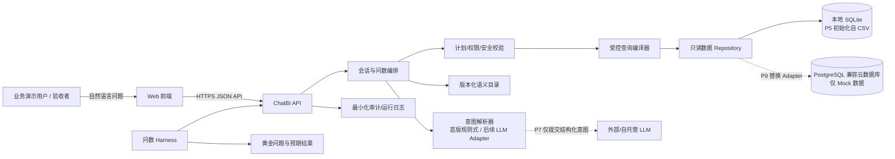
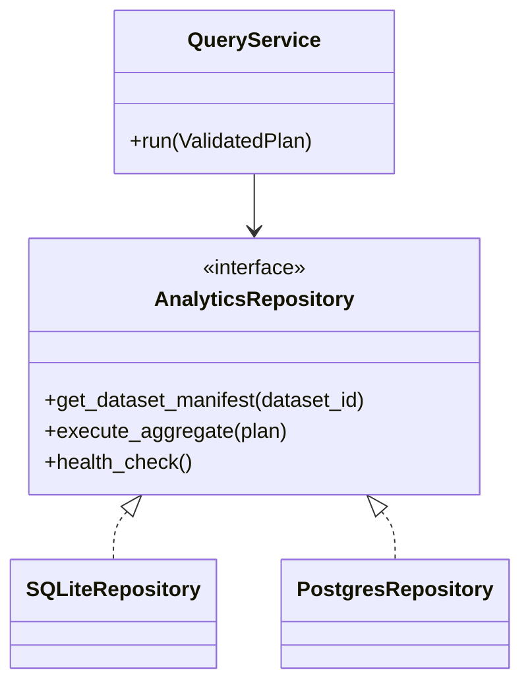

# 通用 ChatBI 平台软件设计说明（SDD）

- 版本：0.1（P4 评审稿）
- 状态：P4 评审通过；P5/P6 阶段门已通过（2026-11-07）；P6 长图评审修正已完成；P7 前置设计进行中，模型服务商与部署/隐私边界待确认
- 日期：2026-11-07
- 依据：PRD v0.3、P3 Mock 数据规范、语义目录和黄金问题集
- 适用范围：电商 Mock ChatBI MVP 及后续模型/云存储扩展路径

## 1. 设计目标与边界

本设计把 PRD 要求拆成可独立替换的界面、会话/问数编排、语义校验、查询执行、存储和评估模块。首版使用确定性解析，不调用大模型；所有答案只从 `ecommerce_mock_v1` Mock 数据产生。后续模型只能生成受控结构化意图，由服务端重新验证后执行。

### 1.1 设计目标

1. 让问题解析、指标定义、查询逻辑和存储实现彼此解耦。
2. 对每个结果保留语义版本、数据集版本、解析计划、查询条件和执行状态，支持复核。
3. 同一查询计划在本地 SQLite 和目标 PostgreSQL 兼容数据库上返回一致结果。
4. 澄清前不执行缺少关键条件的查询；安全校验失败时不触达数据库执行层。
5. 将 LLM 当作不可信的意图建议器，不开放任意 SQL 执行路径。

### 1.2 非目标

- 本阶段不编写应用代码、不接入真实业务数据、不接入 LLM API、不部署云资源。
- 首版不做多租户、RBAC 管理后台、语义词典编辑器或任意数据源即插即用。
- UQ-07 使用独立退款订单率模板；只读取 `completed` 退款并按商品和订单去重，不改变销售额。
- 不在未选定云厂商前写厂商专属部署脚本或服务依赖。

## 2. 已确认约束、设计建议与待决定项

| 类别 | 决定/建议 | 来源/状态 |
|---|---|---|
| 已确认 | 全程仅使用合成 Mock 数据；初始本地、最终云数据库 | 项目约束与 P3 |
| 已确认 | 首版确定性问数；后续才接入 LLM | PRD OPEN-02 |
| 已确认 | 上海时区、完整自然日；销售额按支付日、退款不扣减 | P3 语义目录 |
| 已确认 | 澄清前不查询；结果展示指标口径、时间范围、条件；SQL 在调试视图 | PRD |
| 已接受 | React + TypeScript + Vite；Python + FastAPI + Pydantic；SQLAlchemy；Python Harness/生成器 | 项目方 2026-11-07 明确接受；P5 锁定版本 |
| 已接受 | 本地 SQLite；云端 PostgreSQL 兼容服务；统一 Repository/SQLAlchemy 映射 | 项目方接受类别，具体云供应商/地区/成本留 P9 |
| 已接受 | 数据库存储金额使用整数“分”；CSV/API 边界用两位小数字符串，统一由后端转换 | 项目方 2026-11-07 明确接受；不改变 P3 指标公式和展示单位 |
| 待决定 | 云数据库/云平台/地区、预算、网络、备份与监控选型 | P9 前核实；不阻碍 P4 的供应商无关设计 |
| 待决定 | 对公网发布前的登录/认证方式与访问人群 | 需在外部可访问部署前决定；初期本地开发只绑定本机地址 |
| 已决定 | 技术栈建议已批准 | 项目方 2026-11-07 确认；P5 开始建立工程骨架 |
| 待定基线 | 最大响应时间、并发量、查询超时、结果行数上限 | 在 P5/P7 实际运行和安全约束下测基线；配置项先保留，不虚构门槛 |

## 3. 系统上下文与容器架构



### 3.1 请求主路径

1. Web 校验空输入并提交用户问题、会话 ID 和可选的澄清回复关联 ID。
2. 编排器读取当前数据集与语义目录版本，建立请求上下文。
3. `IntentResolver` 首版由确定性规则实现；后续可换成 LLM Adapter。Resolver 只能返回受限计划草案或澄清/不支持状态。
4. 计划验证器检查指标/维度 ID、时间窗口、过滤值、粒度关系、上下文继承和查询上限。失败时返回澄清/拒绝，不执行 SQL。
5. 查询编译器只从服务端模板和白名单字段生成只读参数化查询。
6. Repository 执行查询并返回类型化结果；结果整形器生成数值/表格/图表类型及解释依据。
7. API 返回答案、标准解析、查询条件、口径、Mock 标记和版本。调试 SQL 经单独授权/配置的端点读取。

### 3.2 会话与澄清

- 澄清状态、已完成查询状态和新问题状态分开建模；澄清答案必须引用待澄清 turn，避免误把任意下一句拼接进旧计划。
- 对 UQ-04–06、UQ-09，第一轮只返回 `clarification_required`，不调用查询编译器/Repository。
- 用户补充时间或比较周期后，系统把它合并到待澄清计划，重新完整校验并再次展示解析结果；随后执行原问题。
- 普通追问只继承 PRD 允许继承的上一轮明确指标和时间范围，允许增加/调整一个维度。禁止隐式继承未明确筛选、跨主题推断和复杂链式分析。
- 会话无法解析、状态过期或语义版本不兼容时要求用户重述，不尝试猜测补齐。

## 4. 模块职责与边界

| 模块 | 输入 → 输出 | 必须负责 | 不得负责 |
|---|---|---|---|
| Web UI | 问题/澄清 → 结果卡、表格、图表、依据 | 加载/澄清/成功/空/错误状态；展示解析和查询条件；格式化结果 | 计算指标、拼 SQL、保存模型密钥 |
| API 层 | HTTP DTO → 领域请求/响应 | 参数校验、请求 ID、统一错误映射、限流挂点 | 判断指标业务含义或直接访问 ORM 表 |
| 会话服务 | 当前 turn + 有限上下文 → 问数状态 | PRD 上下文规则、澄清关联、多轮边界 | 任意历史对话全文自动继承 |
| IntentResolver | 文本 + 语义版本 → 结构化计划草案/澄清 | 首版词法/模式匹配；P7 模型适配实现相同接口 | 生成最终可信 SQL、绕过语义目录 |
| SemanticCatalog | 稳定 ID → 指标/维度/关系/术语定义 | 加载版本、校验引用、提供受控名称和口径 | 在运行时静默改写定义 |
| PlanValidator | 草案 + 目录 + 会话 → 可执行计划或阻止结果 | 白名单、时间、维度粒度、权限、安全、复杂度约束 | 对未知内容“尽力猜测” |
| QueryCompiler | 可信计划 → 参数化只读查询 | 选择预定义查询模板；绑定参数；生成调试 SQL 摘要 | 接受用户或模型提供的 SQL 文本 |
| Repository | 查询对象 → 数据结果 | 本地/云存储映射、事务、只读连接、分页/限制 | 定义销售额或客单价口径 |
| ResultPresenter | 类型化结果 + 计划 → 展示 DTO | 依据数据映射为 KPI/折线/排序表格/柱状图 | 修改数值、制造无数据行或因果结论 |
| Harness | 黄金集 + 执行目标 → 报告 | 正例/澄清/拒答/安全负例回归，比较版本 | 以语言模型裁判取代精确值校验 |
| LLM Adapter（P7） | 最少必要上下文 → JSON 意图建议 | 供应商封装、超时/重试/脱敏/成本观测 | 接收全量业务行或直接连数据库 |

建议的代码边界：`frontend/`、`backend/chatbi/`、`backend/alembic/`、`semantic/`、`scripts/`、`harness/`。P5 工程骨架可逐步细分 API/application/domain/infrastructure 包；不得让 UI、API 路由或 LLM Adapter 直接拼接业务 SQL。

## 5. 查询计划与语义模型

### 5.1 计划对象

计划由后端解析并校验，接口字段只允许语义目录中的 ID。

```json
{
  "dataset_id": "ecommerce_mock_v1",
  "dataset_version": "1.0.0",
  "semantic_catalog_id": "ecommerce_mock_semantics",
  "semantic_catalog_version": "0.1.0",
  "metric_ids": ["sales_amount", "order_count"],
  "dimension_ids": [],
  "time_range": {
    "timezone": "Asia/Shanghai",
    "start_inclusive": "2026-07-31",
    "end_exclusive": "2026-08-01"
  },
  "filters": [],
  "sort": [],
  "limit": null,
  "comparison_period": null,
  "clarification_state": "none"
}
```

### 5.2 计划校验顺序

1. 数据集 ID/版本和语义目录 ID/版本受服务端支持。
2. 所有指标、维度、过滤字段和值都在目录白名单内，且指标由固定查询模板执行（UQ-07 退款订单率按 allowlist 查询）。
3. 时间采用 `Asia/Shanghai` 半开自然日区间，落在数据集覆盖范围内；缺时间或比较期时先澄清。
4. 指标粒度与维度关系兼容；类目统计只允许唯一主要叶子类目；跨类目订单数按类目内去重。
5. 追问继承符合 PRD；过滤条件仅按受支持规则调整。
6. Top N、输出行数、执行超时/资源预算在服务端配置中受限；阈值 P5/P7 压测后定标。
7. 生成受控查询对象和参数；校验失败时不进入 Repository。

### 5.3 物理数据模型

P3 CSV 字段为输入/交换格式。P5 本地数据库采用统一逻辑表：`orders`、`order_items`、`products`、`categories`、`channels`、`customers`、`refunds`。主外键与 P3 粒度一致；`products.primary_leaf_category_id` 指向一个 `level=2` 节点。退款事件表供 UQ-07 商品退款订单率使用；其他销售指标仍按折后实付计算且不扣退款。

| 数据库列组 | 逻辑映射 | 约束 |
|---|---|---|
| ID/FK | 稳定 TEXT/VARCHAR 键 | 主键唯一，外键约束启用；不得因导入改变 ID |
| 金额 | 有符号范围受控的 BIGINT cents（设计建议） | 非负；CSV/HTTP 入出边界转换为十进制字符串；内部禁止 float |
| 时间 | UTC instant + 原始业务时区规则 | 写入为带时区时间；日/月/周过滤先从上海本地自然边界转 UTC，再用半开区间 |
| 状态/枚举 | TEXT/VARCHAR + 检查约束 | 仅接受 P3 字典中枚举值 |
| 结果展示 | `decimal string` + currency | 例如 `"257984.80"`，避免 JSON 二进制浮点误差 |

导入器读取 CSV 与 manifest，先暂存、检查行数/摘要/主外键/金额，再一次性提交数据库初始化；失败回滚并保留可读错误。生成器负责 CSV；Seeder 负责数据库。两者不能混成一个隐式启动副作用。

> 存储金额使用整数分已由项目方在 P4 批准；P3 的逻辑口径仍是 CNY 两位小数。P5 在数据库模型与导入器中实施转换；这不改变指标公式或展示单位。

## 6. API 契约（建议 v1）

API 使用 JSON、UTF-8、`/api/v1` 版本前缀；所有响应含 `request_id`。实现时以 Pydantic/OpenAPI schema 固化。

### 6.1 建立会话

`POST /api/v1/sessions`

请求：`{"dataset_id":"ecommerce_mock_v1"}`

成功：`{"session_id":"...","dataset_id":"ecommerce_mock_v1","dataset_version":"1.0.0","semantic_catalog_version":"0.1.0"}`

### 6.2 提交问题或澄清回答

`POST /api/v1/sessions/{session_id}/turns`

请求：

```json
{
  "question": "昨天的销售额和订单数是多少？",
  "clarifies_turn_id": null
}
```

成功查询的响应形状：

```json
{
  "request_id": "req_...",
  "turn_id": "turn_...",
  "status": "completed",
  "answer": {"text": "...", "values": [{"metric_id": "sales_amount", "value": "257984.80", "unit": "CNY"}]},
  "interpretation": {"metric_ids": ["sales_amount", "order_count"], "dimension_ids": [], "time_range": {"timezone": "Asia/Shanghai", "start_inclusive": "2026-07-31", "end_exclusive": "2026-08-01"}, "filters": []},
  "evidence": {"dataset_id": "ecommerce_mock_v1", "dataset_version": "1.0.0", "semantic_catalog_version": "0.1.0", "metric_definitions": ["..."]},
  "visualization": {"type": "kpi", "data": []},
  "debug_ref": null
}
```

澄清响应使用 `status="clarification_required"`、`clarification_id`、缺失字段及可读问题；该状态无 `answer.values`，且执行记录标明 `query_executed=false`。拒绝/错误使用统一 `error` 对象，不把堆栈回传。

### 6.3 调试查询

`GET /api/v1/debug/queries/{query_id}` 返回经安全审查的结构化计划、模板 ID、绑定参数摘要、执行耗时/行数；验收环境可显示编译后的只读 SQL。生产/公网环境默认禁用或要求受保护的调试角色。不得返回连接串、环境变量、密钥、原始全量行或未经裁剪的日志。

### 6.4 错误代码

| 代码 | HTTP 建议 | 行为 |
|---|---:|---|
| `INVALID_REQUEST` | 400 | 请求结构错误；不执行 |
| `SESSION_NOT_FOUND` | 404 | 会话不存在/不可访问 |
| `CLARIFICATION_REQUIRED` | 200 状态结果 | 正常业务状态，不视作服务错误；不执行查询 |
| `UNKNOWN_TERM` | 200 状态结果 | 说明未识别并给可用术语；不执行 |
| `UNSUPPORTED_QUERY` | 200 状态结果 | 明确范围/指标不支持；不执行 |
| `QUERY_REJECTED` | 403 | 权限/策略拒绝；记录安全事件 |
| `QUERY_LIMIT_EXCEEDED` | 422 | 超出可配置范围/复杂度；不执行 |
| `DATA_SOURCE_ERROR` | 503 | 数据源不可用；不返回假值 |
| `QUERY_TIMEOUT` | 504 | 查询超时；不返回部分伪结果 |
| `INTERNAL_ERROR` | 500 | 提供 request ID，详细异常仅记在受控日志 |

## 7. 语义解析与 LLM 接入路径

### 7.1 首版确定性解析

`IntentResolver` 接口输入为标准化问题、目录版本和允许的会话摘要；输出是 `PlanDraft`、澄清问题或不支持结果。规则按精确指标词、已批准术语、明确时间表达、目录实体名/别名逐项匹配。多指标/维度冲突、未知术语、缺少必需时间、周期边界不明确时停止并澄清。匹配规则带稳定版本和单元语义样例。

### 7.2 P7 模型适配

- 供应商实现统一 `LLMProvider` 接口，密钥只从后端 Secret/环境注入；前端永不接触模型密钥。
- 模型输入限于当前问题、必要的已批准上下文摘要、相关语义定义及允许值；默认不发送整表或明细数据行。
- 要求模型输出严格 JSON `PlanDraft`；模式解析失败、字段越权、未知 ID 或关系不合法均不执行。
- LLM 返回仍经第 5.2 节完整校验。模型超时/不可用时回到确定性解析或说明暂不可用，不编造答案。
- 对外部模型发送自然语言问题前做敏感信息最小化/脱敏评估；数据行默认不外发。配置需能禁用模型调用并回归确定性路径。
- 每次评估记录代码、提示模板、模型供应商/模型 ID、语义目录、黄金集版本；不记录密钥，问题/提示原文按隐私策略最小化保存。

## 8. 安全、权限与隐私设计

1. **只读**：数据库运行身份没有写权限给问数服务；Seeder 使用独立初始化权限。查询事务设置只读（数据库支持时）并由计划编译器生成 SELECT。
2. **受控查询**：不接受模型/用户 SQL；指标/维度/字段/排序/过滤均由枚举映射到服务端表达式；所有值参数化绑定。
3. **数据范围**：限定固定数据集 ID、manifest 版本和日期窗口；拒绝跨表未登记 join、超出范围及未支持的查询形态。
4. **资源限制**：配置查询超时、返回行数、Top N、会话频率和并发上限；先以安全默认值限制，P5/P7 用基线调整。慢查询和被拒查询可观测。
5. **敏感配置**：`.env` 不提交；云端密钥使用 Secret 管理；启动检查缺项但错误信息不回显值；日志脱敏。
6. **隐私**：Mock 文件不得含真实人名/账户/地址；用户问题和日志也按最小化原则处理；查询结果只返回汇总/受控明细，不默认暴露客户标识。
7. **会话隔离**：每个 session 只能引用服务端已保存的状态；外部部署必须验证会话归属。具体认证方式须在公网部署前决策。
8. **调试视图**：只在验收/本地受控环境启用；生产关闭或受角色/网络限制；SQL 不在普通 API 回答中。
9. **提示注入**：把所有用户文本和模型文本视为不可信数据；模型无工具直连 DB；禁止提示文本覆盖系统白名单、权限或数据边界。

安全链路：`请求结构检查 → 会话/用户授权 → 意图解析 → 语义与权限校验 → 时间/复杂度校验 → 参数化受控查询 → 结果投影 → 脱敏展示/审计`。任一步拒绝即短路，数据库执行次数应为零。

## 9. 存储适配与本地到云迁移

### 9.1 接口边界

领域服务依赖 `AnalyticsRepository`，而不是 SQLAlchemy Session、SQLite 文件或云 SDK。接口包含 `get_dataset_manifest`、`execute_aggregate(ValidatedPlan)`、`health_check`；不提供 `execute_sql(string)`。具体查询模板/表映射留在 infrastructure adapter。



### 9.2 迁移流程

1. 选定 PostgreSQL 兼容云服务、区域、网络边界、费用和备份策略（P9）。
2. 使用版本化 migration 建 schema；通过 manifest 校验 CSV 后导入 Mock 数据。
3. 在迁移前后比较每表行数、主外键、金额分币总和、每日有效订单连续性及所有黄金结果。
4. 切换 Repository 配置，不改领域语义/计划校验；预生产运行一轮完整 Harness。
5. 记录回滚点；切回本地/上一个云连接配置，重导 Mock 数据即可重建，不迁移任何真实业务数据。

### 9.3 备份/恢复

云端仅存 Mock 数据。P9 决定自动快照频率、保留期、加密、恢复目标和演练责任；P4 要求提供可重建数据的 Seeder 与 migration，使备份损坏时可按固定版本重建。连接凭据与业务查询配置分离。

## 10. 部署、配置与可观测性

### 10.1 环境

| 环境 | 预期组成 | 数据边界 |
|---|---|---|
| 本地开发 | Vite 前端、FastAPI、SQLite、版本化语义文件 | 固定 Mock CSV 导入的本地数据库 |
| 验收/CI | 同版本代码、数据、语义目录、黄金集；可一次性重建 | 仅 Mock；不要求外部 LLM |
| 云端演示 | 静态前端 + API 服务 + 私网 PostgreSQL + Secret 管理/监控 | 仅 Mock；对公网开放前完成认证和网络决策 |

具体托管供应商、云区和成本在 P9 选；容器化 API 和静态前端可作为候选部署包，云部署实现留待 P9。

### 10.2 配置分类

- 非密钥：`DATASET_ID`、manifest 路径/版本、语义目录版本、数据库适配器、时区、结果限制、调试视图开关。
- 密钥：数据库 URL/密码、未来 LLM key、认证密钥。只从环境/Secret 加载，不进入前端构建产物、日志或仓库。
- 启动时校验必要配置和 schema/manifest 兼容性；缺项时快速失败并给安全错误说明。

### 10.3 事件与观测字段

每次请求记录 `request_id`、session/turn/query ID、数据集和语义版本、状态分类、校验结果代码、执行耗时、结果行数、是否使用模型、模型/提示版本（P7）和费用（可得时）。问题原文、SQL 参数和结果行不得默认写入普通日志；验收调试记录需受控、可清除并避开密钥/个人信息。

健康检查分为进程存活、数据库可连接、数据集/语义目录版本兼容；不可用项需区分展示，避免把数据库错误解释成零结果。

## 11. 质量属性与验证策略

| 属性 | 设计要求 | 验证方式/门槛 |
|---|---|---|
| 正确性 | 口径只来源语义目录；查询结果精确匹配固定数据 | P5 核验 Mock/Seeder；P6 HTTP Harness 对 UQ-01–06、UQ-08–10 的黄金用例精确核对 |
| 安全 | 未验证计划不可执行；模型不能直连数据库 | 安全负例、未知字段、注入、越权用例；负例被拦截且无 Repository 调用 |
| 可复现 | 版本/计划/数据一致时同结果 | 主/夹具 manifest SHA、黄金结果和执行报告保存版本 |
| 可解释 | 每个回答显示指标定义、时间、筛选、数据版本和图表类型 | API schema/UI 验收逐条核对 |
| 可迁移 | Repository 替换不改领域服务 | P9 两种 Adapter 对比全部黄金结果 |
| 可观察 | 请求、校验、查询、错误可按 ID 关联 | P5 建立请求 ID/HTTP 元信息日志与 Trace schema；P6 接入查询模板 ID、耗时和行数日志，不记录问题正文或查询参数 |
| 性能 | 记录端到端及分阶段延迟，限制资源消耗 | P5 本地、P7 模型分别建立基线后由项目方定目标；P9 云端复测 |
| 可用性/失败恢复 | 超时、数据库故障、模型故障不伪造答案 | 故障模拟返回规定错误状态；模型不可用时可退回确定性路径 |

所有数字门槛以 PRD 已确认的正确率/关键负例要求和后续性能基线为准，本设计不另造毫秒、并发或可用性承诺。

## 12. PRD 到设计/接口/验收追踪

| PRD | 设计落点 | API/模块 | P3/Harness 验证 |
|---|---|---|---|
| FR-001 Mock-only | 环境/存储/结果标记 | Session、Repository、ResultPresenter | manifest 版本；所有成功响应含 Mock 数据集证据 |
| FR-002 状态与输入 | API 生命周期/前端状态机 | sessions/turns | 空输入、处理中、完成/失败 |
| FR-003 结构化理解 | PlanDraft/Plan schema | IntentResolver、turn response | UQ 黄金计划字段核对 |
| FR-004 澄清 | pending clarification 状态机 | turns API | UQ-04–06、09 第一轮 query_executed=false |
| FR-005 语义目录范围 | catalog ID 白名单 | SemanticCatalog、PlanValidator | 未知指标/维度/关系负例 |
| FR-006 只读安全 | 计划校验/受控查询编译 | Validator、Compiler、Repository | 写操作、任意 SQL、越权/注入拒绝 |
| FR-007 图表 | typed visualization DTO | ResultPresenter、Web UI | KPI/line/bar/table 数据与值一致 |
| FR-008 口径/条件 | interpretation/evidence | turn response | 解析、时间范围、筛选、口径完整 |
| FR-009 错误/无结果 | error envelope 与状态映射 | API/application | 无数据/超时/依赖故障，不造数 |
| FR-010 有限追问 | 明确 session context 与一次维度调整限制 | SessionService | 多轮正例/越界上下文负例 |
| FR-011/012 Should | 推荐问题/反馈模块预留 | API/UI 后续 | 单独需求确认后补用例 |
| FR-013 调试 SQL | 隔离 debug resource | Debug API | 调试视图权限/禁用开关；普通答案无 SQL |
| FR-014 LLM 后续 | Provider 接口 + JSON 计划 + 全量重校验 | LLM Adapter (P7) | 格式错误、注入、越权、故障回归 |
| FR-015 本地→云 | `AnalyticsRepository` + migrations/seeder | SQLite/Postgres Adapter | P9 行数/FK/金额/黄金结果一致 |

## 13. 推荐代码分层与执行顺序

1. `backend/chatbi`：逐步容纳 domain/application/infrastructure/api；P5 先建立 FastAPI 入口、数据库模型/连接、Seeder、日志与健康检查。
2. `semantic`：版本化目录、术语/时间解析与目录校验，在查询解析阶段逐步实现。
3. `frontend`：问题区、会话状态、澄清、结果/证据、受控调试 UI；P5 只建立运行骨架。
4. `harness`：P5 核验 manifest、Seeder、数据口径参考值和空日夹具；P6 增加端到端 HTTP Golden Adapter，覆盖澄清、查询结果和拒答。

P5 实现顺序：静态检查/运行骨架 → DB schema 和 Seeder → API/前端健康检查 → 数据与 Seeder Harness → 脱敏 Trace/request logging → 重复性核验。P6 已按此边界接入 UQ-01–06、UQ-08–10 确定性问数 API、澄清、结果展示和 HTTP Golden Adapter；LLM 属于 P7。

## 14. P4 评审问题

以下设计决定已由项目方确认：

1. 推荐技术栈获批：React + TypeScript + Vite、Python + FastAPI + Pydantic、SQLAlchemy、SQLite 本地。
2. 金额整数分存储获批：例如数据库整数 `25798480` 对应 CSV/API 十进制字符串 `257984.80`；转换统一由后端执行。
3. PostgreSQL 兼容云数据库类别获批；云厂商、地区、成本留到 P9 比较。
4. 公网访问前需补定认证和访问控制；本地开发只监听本机地址。

P5 已锁定依赖版本、数据库 migration 及运行命令，并完成最小骨架、Mock Seeder、健康检查与数据 Harness。P6 已完成确定性问数闭环并通过 54 项 HTTP Golden 检查；LLM 留 P7，云厂商留 P9，性能基线按路线图后续阶段实测。

## 15. P7 大模型接入补充设计

P7 详细规格、验收和任务见 [`P7_LLM_QUERY_SPEC.md`](P7_LLM_QUERY_SPEC.md)。服务商选择完成前，真实 Provider 保持未配置。

模型只接收当前问题、必要的有限会话上下文和版本化语义定义，不接收订单/顾客/商品明细。模型返回严格 Pydantic 意图草稿；服务端校验指标、维度、关系、粒度、时区/日期边界、过滤、排序、限制、权限和支持范围，再映射到现有白名单查询模板。禁止模型 SQL 或模型生成的数字直接进入答案。校验失败时不执行查询，可由确定性解析器回退到 P6 已覆盖问题；模型/服务故障不得生成猜测答案。

任何外部模型调用均需按项目方选定的服务商、区域、数据留存和预算策略执行；密钥只在后端环境/Secret 中配置。Harness 增加模型响应 Schema、计划校验、安全负例、模拟服务故障和黄金结果不变性检查；性能、费用和准确率先实测形成基线，再由项目方批准目标值。


\n